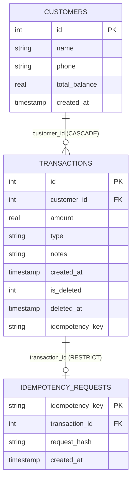

# KhataFlow Backend Ledger & Database Module

This document provides a comprehensive technical reference for the KhataFlow backend database and ledger module. It serves as the integration manual for connecting the ledger module with the voice AI pipeline and REST/WebSocket API layers.

---

## 1. Database Architecture & Schema

KhataFlow uses an embedded SQLite database configured for high-concurrency kirana ledger bookkeeping.

### A. Connection PRAGMAs
Every database connection strictly enforces:
- `PRAGMA foreign_keys = ON;` (Ensures relational integrity and cascading/restrict rules)
- `PRAGMA journal_mode = WAL;` (Write-Ahead Logging allows concurrent readers alongside writers)
- `PRAGMA busy_timeout = 5000;` (Prevents immediate lock failure during concurrent transactions)

### B. Relational Schema & Tables



#### Table Definitions:
1. **`customers`**:
   - `id INTEGER PRIMARY KEY AUTOINCREMENT`
   - `name TEXT NOT NULL`
   - `phone TEXT`
   - `total_balance REAL DEFAULT 0.0` (Normalized 2-decimal floating point, computed in Decimal)
   - `created_at TIMESTAMP DEFAULT CURRENT_TIMESTAMP`

2. **`transactions`**:
   - `id INTEGER PRIMARY KEY AUTOINCREMENT`
   - `customer_id INTEGER NOT NULL REFERENCES customers(id) ON DELETE CASCADE`
   - `amount REAL NOT NULL`
   - `type TEXT NOT NULL CHECK(type IN ('CREDIT', 'PAYMENT', 'CORRECTION'))`
   - `notes TEXT`
   - `created_at TIMESTAMP DEFAULT CURRENT_TIMESTAMP`
   - `is_deleted INTEGER DEFAULT 0` (0 = active, 1 = soft deleted)
   - `deleted_at TIMESTAMP DEFAULT NULL`
   - `idempotency_key TEXT DEFAULT NULL`

3. **`idempotency_requests`**:
   - `idempotency_key TEXT PRIMARY KEY`
   - `transaction_id INTEGER NOT NULL REFERENCES transactions(id) ON DELETE RESTRICT`
   - `request_hash TEXT` (Deterministic SHA-256 fingerprint)
   - `created_at TIMESTAMP DEFAULT CURRENT_TIMESTAMP`

### C. Performance Composite Indexes
- `idx_transactions_customer_active`: `(customer_id, is_deleted, created_at DESC)` (Optimizes customer passbook queries)
- `idx_transactions_recent_active`: `(is_deleted, id DESC)` (Optimizes global recent transactions passbook)
- `idx_idempotency_requests_tx_id`: `(transaction_id)` (Accelerates reverse lookups and delete checks)

---

## 2. Customer Management Operations

Class: `LedgerManager(db_path: str = "khataflow.db")`

### `get_all_customers() -> List[Dict[str, Any]]`
Fetches all customers ordered by outstanding debt descending, then name alphabetically.

```python
customers = await manager.get_all_customers()
# Returns: [{'id': 1, 'name': 'Ramesh Gupta', 'phone': '9876543210', 'total_balance': 350.0, 'created_at': '2026-11-12 21:00:00'}, ...]
```

### `get_or_create_customer(name: str, phone: Optional[str] = None) -> Dict[str, Any]`
Searches case-insensitively for an exact name match. If missing, atomically creates the customer with `total_balance = 0.0`.

```python
customer = await manager.get_or_create_customer("Suresh Sharma", "9988776655")
```

### `find_customers_by_name(name: str) -> List[Dict[str, Any]]`
Searches for customers by exact match first, then by substring/first-name search (`%name%`).

---

## 3. Transaction Operations

### `record_transaction(...) -> Tuple[Dict[str, Any], float]`
Records a financial transaction inside an atomic write lock (`BEGIN IMMEDIATE;`) and updates customer balance.

**Signature:**
```python
async def record_transaction(
    customer_id: int,
    amount: float,
    tx_type: str,            # Must be 'CREDIT' or 'PAYMENT'
    notes: str = "",
    idempotency_key: Optional[str] = None
) -> Tuple[Dict[str, Any], float]:
```

**Example:**
```python
tx, new_balance = await manager.record_transaction(
    customer_id=1,
    amount=150.50,
    tx_type="CREDIT",
    notes="1kg dal, 2kg cheeni",
    idempotency_key="req_abc123"
)
# Returns:
# tx = {'id': 14, 'customer_id': 1, 'amount': 150.50, 'type': 'CREDIT', 'notes': '1kg dal, 2kg cheeni', 'created_at': '2026-11-12 23:00:00', 'customer_name': 'Ramesh Gupta'}
# new_balance = 500.50
```

### `get_customer_transactions(...) -> List[Dict[str, Any]]`
Retrieves customer passbook history with strict multi-customer isolation and pagination.

**Signature:**
```python
async def get_customer_transactions(
    customer_id: int,
    limit: int = 20,    # 1 to 100
    offset: int = 0     # >= 0
) -> List[Dict[str, Any]]:
```
- Strictly excludes soft-deleted rows (`WHERE is_deleted = 0`).
- Sorted newest-first: `ORDER BY created_at DESC, id DESC`.

---

## 4. Financial Calculations & Rules

All financial calculations occur in pure Python using `decimal.Decimal` with 2-decimal paisa quantization (`ROUND_HALF_UP`).

$$\text{Quantization: } \text{Decimal}(str(x)).\text{quantize}(\text{Decimal}("0.01"), \text{rounding}=\text{ROUND\_HALF\_UP})$$

### Rules:
- **CREDIT (Udhaar)**: Adds to customer balance ($\text{balance} \leftarrow \text{balance} + \text{amount}$). Represents money owed to the shop.
- **PAYMENT (Jama)**: Subtracts from customer balance ($\text{balance} \leftarrow \text{balance} - \text{amount}$). Represents settlement.
- **Negative Balances**: Fully supported and valid. Represents advance customer deposits (advance jama).
- **SQLite REAL limitation**: Stored as IEEE 754 8-byte floating point. Arithmetic is **never** executed inside SQL statements (`UPDATE customers SET total_balance = total_balance + ?`) to avoid binary floating-point drift.

---

## 5. Updates & Soft Deletion

### `update_transaction(...) -> Tuple[Dict[str, Any], float]`
Atomically modifies an existing active transaction's amount, type, or notes. `customer_id` is immutable.

$$\text{old\_contribution} = +\text{old\_amount if CREDIT else } -\text{old\_amount}$$
$$\text{new\_contribution} = +\text{new\_amount if CREDIT else } -\text{new\_amount}$$
$$\Delta = \text{new\_contribution} - \text{old\_contribution}$$
$$\text{new\_balance} = \text{current\_balance} + \Delta$$

```python
updated_tx, new_bal = await manager.update_transaction(
    transaction_id=14,
    amount=200.0,
    notes="Corrected 2kg cheeni"
)
```

### `delete_transaction(transaction_id: int) -> Tuple[Dict[str, Any], float]`
Safely soft-deletes a transaction without dropping the database row:
1. Reverses financial contribution:
   - Soft-deleting `CREDIT`: balance decreases ($\text{balance} \leftarrow \text{balance} - \text{amount}$).
   - Soft-deleting `PAYMENT`: balance increases ($\text{balance} \leftarrow \text{balance} + \text{amount}$).
2. Sets `is_deleted = 1` and `deleted_at = CURRENT_TIMESTAMP`.
3. Preserves row, ID, notes, and idempotency mappings for audit log integrity.
4. Attempting to delete an already deleted row raises a `ValueError` (prevents double balance reversal).

```python
deleted_tx, restored_bal = await manager.delete_transaction(transaction_id=14)
```

---

## 6. Balance Reconciliation & Audit

### `recalculate_customer_balance(customer_id: int) -> Dict[str, Any]`
Reconstructs the customer's true mathematical balance from active transaction records:

$$\text{True Balance} = \sum_{\text{active CREDIT}} \text{amount} - \sum_{\text{active PAYMENT}} \text{amount}$$

- Filters strictly on active transactions (`is_deleted = 0`).
- Validates all active stored amounts using `validate_stored_amount()`.
- Updates `customers.total_balance` inside an atomic transaction.
- Returns reconciliation audit dictionary:

```python
report = await manager.recalculate_customer_balance(customer_id=1)
# Returns:
# {
#     "customer_id": 1,
#     "customer_name": "Ramesh Gupta",
#     "previous_balance": 9999.99,  # Previous (possibly tampered) balance
#     "recalculated_balance": 500.50, # True calculated sum
#     "difference": -9499.49,
#     "has_discrepancy": True
# }
```

---

## 7. Idempotency & Request Fingerprinting

### Fingerprint Formulation
When `idempotency_key` is supplied to `record_transaction()`, a deterministic SHA-256 fingerprint is calculated:

$$\text{payload} = \text{customer\_id} : \text{normalized\_amount} : \text{normalized\_type} : \text{trimmed\_notes}$$
$$\text{request\_hash} = \text{SHA256}(\text{payload})$$

### Replay & Conflict Rules:
- **Same key + same payload**: Returns original transaction record; customer balance is not modified again (safe replay).
- **Same key + different customer/amount/type/notes**: Raises `IdempotencyConflictError` (HTTP 409 Conflict); customer balance and transaction table remain untouched.
- **Relational Integrity**: `idempotency_requests` uses `ON DELETE RESTRICT` to prevent physical removal of referenced transaction rows.

---

## 8. Defensive Validation Rules

Centralized helper: `validate_stored_amount(raw_amt, tx_id, action_context)`:
- Rejects `NULL` / `None`
- Rejects boolean values (`True`/`False`)
- Rejects non-numeric types
- Rejects `NaN`, `+Infinity`, `-Infinity` (both float and string representations)
- Rejects `<= Decimal("0.00")` (zero or negative amounts)
- Rejects `CORRECTION` and unsupported transaction types across all methods (`record_transaction`, `update_transaction`, `delete_transaction`, `recalculate_customer_balance`).

---

## 9. Database Initialization & Backup Migration

### `init_db(db_path: str = "khataflow.db")`
1. Creates base tables with PRAGMAs enabled.
2. Checks existing columns (`is_deleted`, `deleted_at`, `idempotency_key`).
3. If migration is required on an existing database:
   - Takes a verified native SQLite backup using `create_database_backup(db_path)` via SQLite Online Backup API.
   - Verifies backup via `PRAGMA integrity_check`, customer counts, transaction counts, exact balances, and exact fields.
4. Performs table rebuild for `idempotency_requests` to establish `ON DELETE RESTRICT`.
5. Backfills missing SHA-256 request hashes.
6. Builds composite indexes.
7. Executes `PRAGMA foreign_key_check;` to guarantee zero violations.
8. Seeds sample kirana accounts if database is empty.

---

## 10. Verification Test Suite Guide

The backend includes six automated verification test suites covering 83 test scenarios.

Run all suites from the project root:

```bash
# Step 1: SQLite config, backup verification & idempotency fingerprinting (10 tests)
python -m backend.scripts.verify_phase1_step1

# Step 2: Customer transaction history pagination & ordering (9 tests)
python -m backend.scripts.verify_step2

# Step 3: Atomic transaction updates & balance delta calculations (13 tests)
python -m backend.scripts.verify_step3

# Step 4: Safe soft deletion & balance reversals (14 tests)
python -m backend.scripts.verify_step4

# Step 5: Balance reconciliation & defensive amount validation (20 tests)
python -m backend.scripts.verify_step5

# Step 6: Cross-function consistency & database integrity audit (17 tests)
python -m backend.scripts.verify_step6
```

All 6 suites can also be executed in a single command:
```bash
python -m backend.scripts.verify_phase1_step1; python -m backend.scripts.verify_step2; python -m backend.scripts.verify_step3; python -m backend.scripts.verify_step4; python -m backend.scripts.verify_step5; python -m backend.scripts.verify_step6
```
Expected result: **83 / 83 Tests Passing (100%)**.
